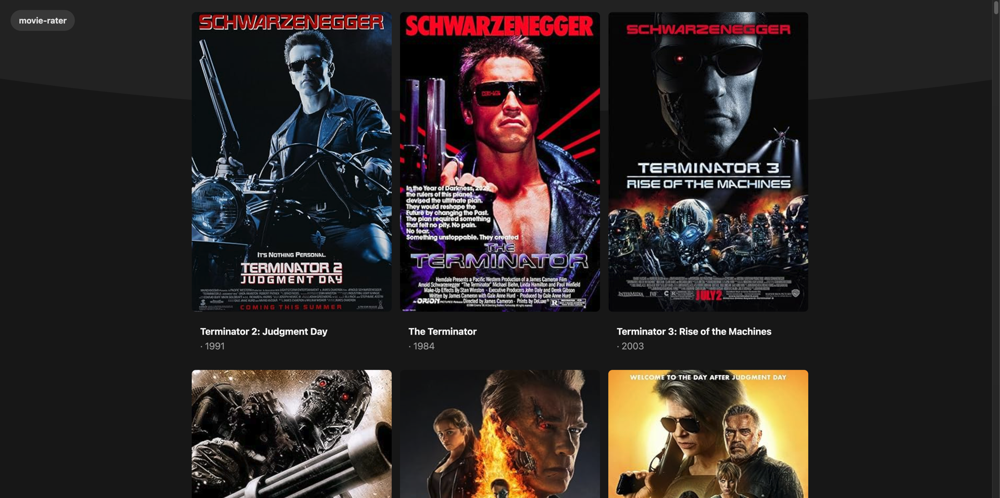

# Movie Reviews

A Flask web application for discovering movies and sharing reviews. Search the OMDb catalog, open a movie’s details, and submit a short review that is stored in MongoDB.

Author: Pranav Khatri

This project was developed at the University of Maryland for **CMSC388J: Building Secure Web Applications** during the **Spring 2025** semester.

## Demo

Demo: [Link](https://youtu.be/2QBcR_uyVeA?si=BiZwFfxUYImI6Ets)



## Highlights

- Search OMDb for movies and browse detailed cast, genre, awards, and plot information.
- Submit and view community reviews for each movie.
- Validate form input and protect submissions with CSRF tokens.
- Keep credentials outside the codebase with environment-based configuration.

## Tech stack

Python, Flask, Jinja, Flask-WTF, MongoDB, and the [OMDb API](https://www.omdbapi.com/).

## Run locally

Prerequisites: Python 3.10+ and a MongoDB database (local or Atlas).

```bash
git clone <your-fork-or-repository-url>
cd movie-reviews
python3 -m venv .venv
source .venv/bin/activate
pip install -r requirements.txt
cp .env.example .env
```

Edit `.env` with the following values:

- `SECRET_KEY`: a long random string for Flask sessions. For example: `python3 -c "import secrets; print(secrets.token_hex(32))"`.
- `MONGO_URI`: a connection string for your own MongoDB database. [MongoDB Atlas](https://www.mongodb.com/products/platform/atlas-database/getting-started) provides a guided setup; allow your development IP and create a database user before copying its connection string.
- `OMDB_API_KEY`: request a personal key from the [OMDb API key page](https://www.omdbapi.com/apikey.aspx).

Then start the development server:

```bash
flask --app flask_app.app run --debug
```

Open `http://127.0.0.1:5000` in your browser. `.env` is ignored by Git; never commit it or share its contents.
